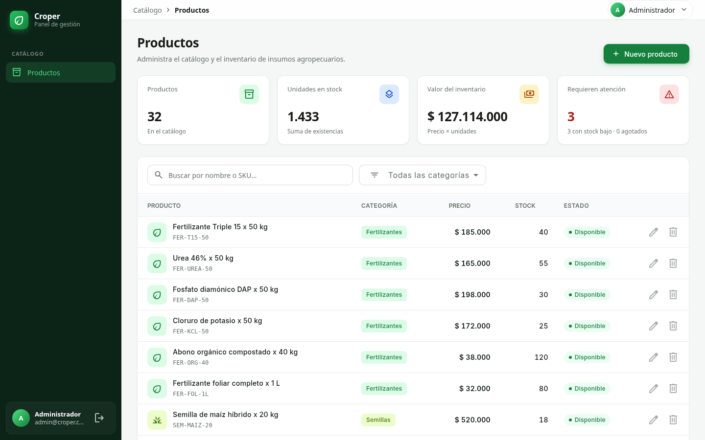
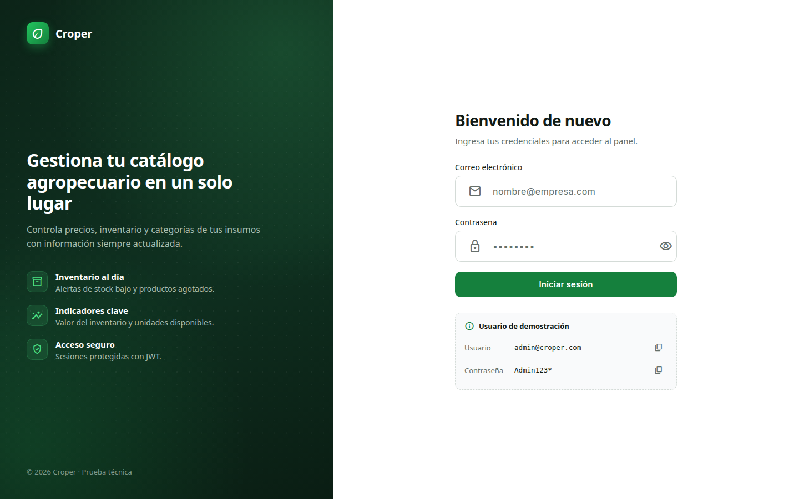
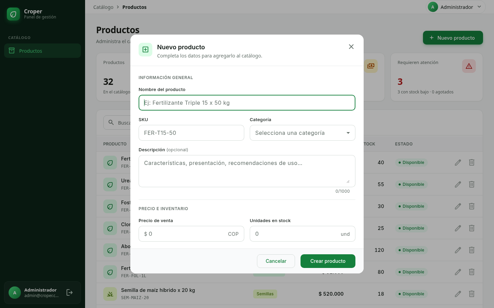
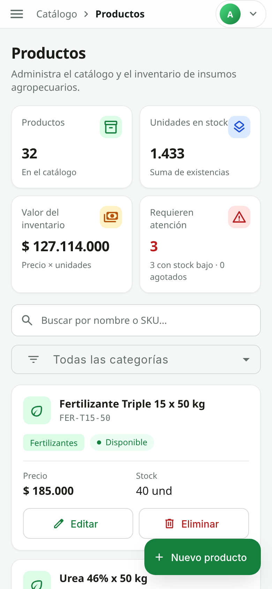
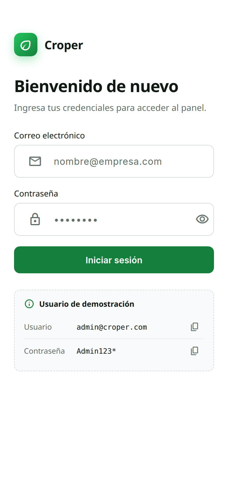

# Croper – Prueba Técnica Desarrollador Full Stack

Panel de gestión de productos para un e-commerce agropecuario: **API REST en NestJS + MongoDB** y **frontend en Angular + NgRx**, con respuestas teóricas de arquitectura, rendimiento y seguridad.



## Entregables

| # | Entregable | Dónde |
|---|---|---|
| 1 | API REST de productos (NestJS + MongoDB, JWT, Swagger) | [`backend/`](backend) |
| 2 | Frontend que consume la API (Angular + NgRx + Material) | [`frontend/`](frontend) |
| 3 | Arquitectura de microservicios para e-commerce agro | [`docs/ejercicio-3-arquitectura.md`](docs/ejercicio-3-arquitectura.md) |
| 4 | Optimización de rendimiento web en móviles (con mediciones) | [`docs/ejercicio-4-rendimiento.md`](docs/ejercicio-4-rendimiento.md) |
| 5 | Seguridad en APIs y cloud | [`docs/ejercicio-5-seguridad.md`](docs/ejercicio-5-seguridad.md) |
| — | **PDF con las respuestas teóricas** (2 versiones) | **Corto (1 hoja):** [`docs/Respuestas_Cortas_Croper.pdf`](docs/Respuestas_Cortas_Croper.pdf)<br/>**Largo (completo, con uso de IA):** [`docs/Respuestas_Teoricas_Croper.pdf`](docs/Respuestas_Teoricas_Croper.pdf) |
| — | Uso de inteligencia artificial: prompts, validación y correcciones | [`docs/USO_IA.md`](docs/USO_IA.md) |

## Inicio rápido

Requisito: **Docker** con Docker Compose.

```bash
cp .env.example .env
docker compose up -d
```

En el primer arranque se crean los usuarios de MongoDB y se cargan datos de demostración (32 productos agropecuarios).

| Servicio | URL |
|---|---|
| **Aplicación web** | **http://localhost:4200** |
| Swagger (documentación de la API) | http://localhost:3000/api/docs |
| API | http://localhost:3000/api (el frontend la usa vía nginx en `/api`) |

**Usuario demo:** `admin@croper.com` / `Admin123*` (en el login hay botones para copiarlos).

> `.env.example` trae valores de ejemplo para que funcione al instante. Fuera de un entorno local se deben cambiar las contraseñas y el `JWT_SECRET` (`openssl rand -hex 32`). `.env` está en `.gitignore`.

<table>
  <tr>
    <td></td>
    <td></td>
  </tr>
  <tr>
    <td align="center">Login</td>
    <td align="center">Crear / editar producto</td>
  </tr>
</table>

<p align="center">
  
  <br />
  Vista móvil
</p>

## Stack

| Capa | Tecnología |
|---|---|
| Backend | NestJS 12 (ESM), Mongoose 9, Passport JWT, class-validator, Swagger, helmet, throttler |
| Base de datos | MongoDB 7 |
| Frontend | Angular 22 (standalone, zoneless, signals), NgRx 22 (Store, Effects, Entity), Angular Material |
| Infraestructura | Docker Compose: `mongo` + `api` + `web` (nginx como servidor estático y proxy de `/api`) |
| Tests | Vitest (unitarios y e2e con Supertest contra MongoDB real) |

## Estructura

```
backend/            API REST NestJS
frontend/           App Angular (+ nginx.conf para producción)
mongo/init/         Script que crea el usuario de la API con mínimo privilegio
docs/               Respuestas teóricas, PDF, uso de IA, diagramas y capturas
docker-compose.yml  Orquestación de los 3 servicios
```

---

## Backend (`/backend`)

### Endpoints

| Método | Ruta | Auth | Descripción |
|---|---|---|---|
| POST | `/api/auth/register` | — | Registro (máx. 5/min por IP) |
| POST | `/api/auth/login` | — | Login → JWT (máx. 5/min por IP) |
| GET | `/api/products?page=&limit=&search=&category=&sortBy=&order=` | JWT | Lista paginada con búsqueda, filtro y orden |
| GET | `/api/products/stats` | JWT | Indicadores: total, unidades, valor del inventario, stock bajo y agotado |
| GET | `/api/products/:id` | JWT | Detalle |
| POST | `/api/products` | JWT | Crear |
| PATCH | `/api/products/:id` | JWT | Actualizar parcialmente |
| DELETE | `/api/products/:id` | JWT | Eliminar |
| GET | `/api/health` | — | Estado de la API y de la base de datos |

### Decisiones técnicas

- **Seguro por defecto:** `JwtAuthGuard` global; solo los endpoints marcados con `@Public()` quedan abiertos.
- **Validación:** DTOs con `class-validator`; `ValidationPipe` con `whitelist` + `forbidNonWhitelisted` (rechaza campos extra y mitiga la inyección de operadores `$` de MongoDB). Las variables de entorno se validan al arrancar (la API no inicia con un `JWT_SECRET` débil).
- **Errores uniformes:** filtro global → `{ statusCode, error, message, path, timestamp }`. SKU duplicado → 409, id inválido → 400, inexistente → 404; los errores 500 no exponen detalles internos.
- **Contraseñas:** bcrypt (12 rondas), `select: false` en el schema y eliminadas del JSON. Login con mensaje genérico y comparación contra un hash ficticio para no revelar si el email existe.
- **Fuerza bruta:** `@nestjs/throttler` (100 req/min en general, 5/min en login y registro) usando la IP real del cliente detrás de nginx (`TRUST_PROXY`), sin permitir que se falsifique.
- **MongoDB con mínimo privilegio:** la API se conecta con `croper_app` (`readWrite` solo sobre su base), creado por `mongo/init/01-create-app-user.js`. El usuario root queda solo para administración.
- **Búsqueda segura:** el texto se escapa antes de construir el `RegExp` (evita ReDoS e inyección de regex).
- **Indicadores** calculados con una agregación en MongoDB (una sola consulta).
- **Docker:** build multi-etapa, imagen final solo con dependencias de producción y usuario no-root. Puertos de MongoDB y de la API publicados solo en `localhost`.

### Desarrollo y tests

```bash
docker compose up -d mongo
cd backend
cp .env.example .env    # MONGO_URI con la clave de MONGO_APP_PASSWORD del .env raíz
npm install
npm run seed            # datos demo (idempotente)
npm run start:dev       # http://localhost:3000/api

npm test                # 8 tests unitarios (ProductsService)
npm run test:e2e        # 13 tests e2e contra MongoDB real (base aislada croper_e2e)
```

---

## Frontend (`/frontend`)

### Estructura

```
src/app/
  core/
    interceptors/        authInterceptor (Bearer) · sessionInterceptor (401 → cerrar sesión)
    guards/              authGuard · guestGuard
    layout/              Shell (menú lateral + barra superior) · authenticated.routes.ts (chunk diferido)
    models/              modelos y helpers visuales (categoría, estado de stock)
    utils/               http-error.ts (códigos HTTP → mensajes en español) · paginador en español
  shared/components/     ConfirmDialog
  features/
    auth/                login + store (actions, reducer con createFeature, effects)
    products/
      data-access/       ProductsApiService
      store/             actions · reducer (EntityAdapter) · effects
      pages/             ProductsPage (contenedor)
      components/        ProductFormDialog · ProductCards (móvil) · StatsCards
```

### Manejo de estado (NgRx)

- **Auth:** sesión (token, expiración, usuario) persistida en `localStorage` y rehidratada al iniciar, descartando tokens vencidos.
- **Products:** `EntityAdapter` + estado de consulta (`page`, `limit`, `search`, `category`, `sortBy`, `order`), `total`, `stats`, `loading`, `saving`, `deletingIds`, `loadError`. El estado y los effects se registran solo al entrar a la ruta.
- Acciones separadas por origen: `Products Page` (UI) y `Products API` (resultados).
- Effects con `switchMap` para cargar (cancela peticiones obsoletas), `exhaustMap` para crear o editar (evita doble envío) y `mergeMap` para eliminar.
- Los componentes leen el store como **signals** (`selectSignal`) con `OnPush`.

### UX y diseño

- Paginación, orden y filtros **del lado del servidor**; búsqueda con `debounce` de 400 ms.
- El formulario **solo se cierra si la API confirma**: un error (ej. SKU duplicado) no hace perder lo escrito.
- Confirmación antes de eliminar; botones deshabilitados y spinners mientras se procesa.
- Esqueletos de carga, estados vacío, "sin resultados" y error con **Reintentar**.
- Mensajes amigables en español para cada tipo de error (sin conexión, 400, 401, 404, 409, 429, 5xx).
- **Responsive:** < 960 px el menú lateral pasa a panel deslizable; < 600 px la tabla se convierte en tarjetas y "Nuevo producto" en botón flotante.
- Sistema de diseño propio (`styles.scss`): tokens de color, Inter, íconos Material Symbols, contraste WCAG AA.

### Rendimiento

Detalle y mediciones en [`docs/ejercicio-4-rendimiento.md`](docs/ejercicio-4-rendimiento.md). Lighthouse móvil, 4G lento, caché vacía:

- **FCP 4–5 s → 0,7 s** con un *app shell* en `index.html`.
- **−40/45 % de peso** por página: íconos en subconjunto auto-alojado (170 KB → 5,9 KB, `npm run icons`) e Inter auto-alojada.
- Área autenticada en un solo chunk diferido: un viaje de red menos (**LCP de productos 5,1 → 4,4 s**).
- nginx: gzip, caché inmutable para assets con hash, `no-cache` para `index.html` y cabeceras de seguridad.

### Desarrollo y tests

```bash
cd frontend
npm install
npm start    # http://localhost:4200, con proxy de /api → localhost:3000
             # (detener antes el contenedor web: docker compose stop web)
npm test     # 16 tests unitarios (reducer de productos y mapeo de errores)
```

---

## Uso de inteligencia artificial

Desarrollado con **Claude Code** (Anthropic) como asistente. En [`docs/USO_IA.md`](docs/USO_IA.md) están los prompts relevantes, cómo se validó cada resultado (tests, pruebas manuales en el navegador, `curl`, mediciones de Lighthouse) y una tabla de **errores detectados y corregidos**. Por ejemplo:

- un rate limiting que bloqueaba a todos los usuarios detrás de nginx;
- cabeceras de seguridad que nginx descartaba;
- mediciones de rendimiento engañosas por la caché.
