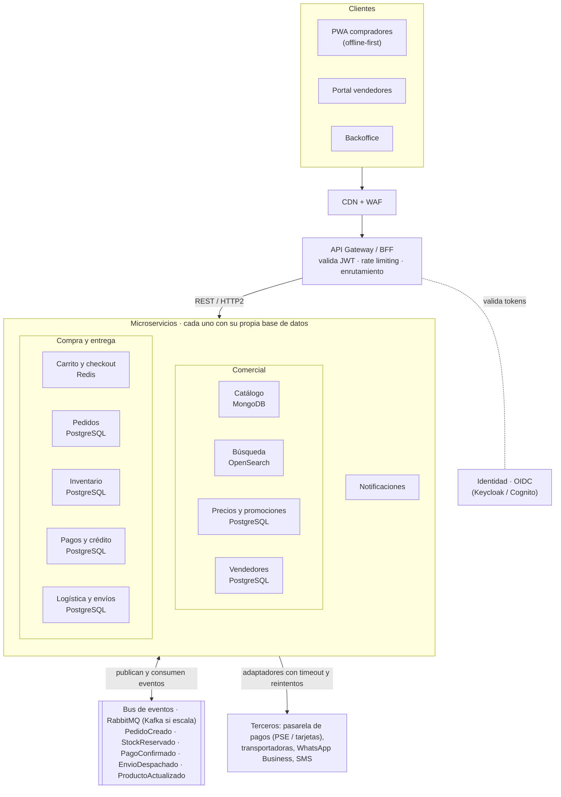
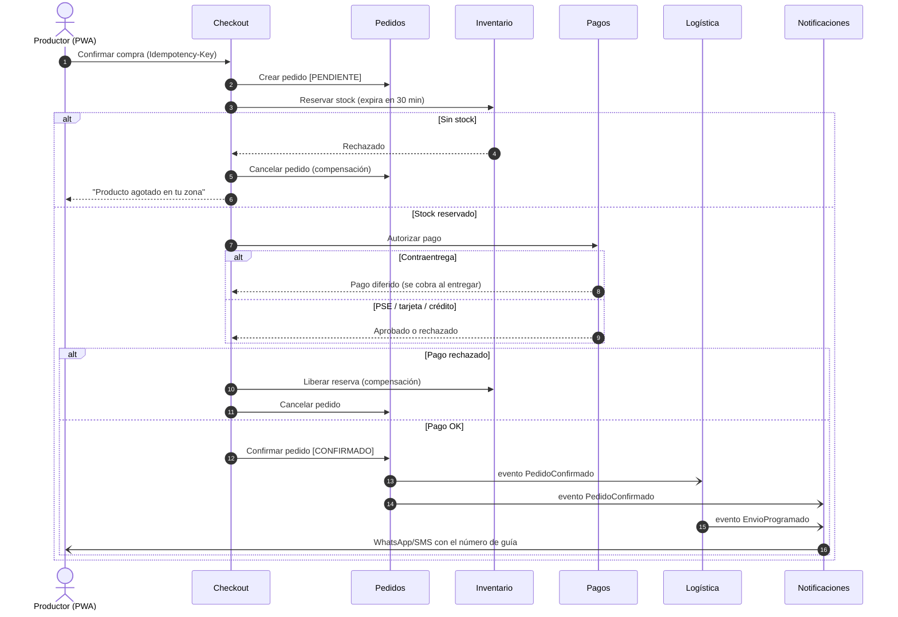

# Ejercicio 3 – Arquitectura de microservicios para un e-commerce agropecuario

> **Supuestos.** Diseño para una plataforma tipo marketplace de insumos agropecuarios (fertilizantes, semillas, agroquímicos, herramientas, nutrición animal) en Colombia, con varios vendedores (distribuidores y casas comerciales) y compradores que son principalmente productores rurales. Los supuestos de negocio están explícitos para que las decisiones se puedan discutir.

---

## 1. Lo que el contexto agro le exige a la arquitectura

| Realidad del negocio | Consecuencia técnica |
|---|---|
| **Conectividad rural intermitente** (3G/4G inestable, celulares de gama media) | Clientes *offline-first* (PWA), APIs **idempotentes** para reintentar sin duplicar pedidos, respuestas pequeñas y paginadas |
| **Estacionalidad fuerte:** picos de demanda en siembra y fertilización, coordinados con las temporadas de lluvia | Escalado horizontal por servicio y **colas** que absorban picos sin perder pedidos |
| **Pago contraentrega, PSE y crédito o financiación** a productores | Pagos como dominio aislado y auditable; pedidos con estados intermedios ("pendiente de pago al entregar") |
| **Logística de última milla a veredas**, con transportadoras regionales y tiempos variables | Integración con varios operadores; seguimiento basado en eventos, no en consultas constantes |
| **Productos regulados** (agroquímicos con registro ICA, restricciones de venta y transporte) | Reglas de catálogo y validaciones en el checkout por producto y región |
| **Precio y disponibilidad por región** (bodegas, fletes) | Inventario por bodega y precios calculados según el destino |
| **Canales que usa el productor:** WhatsApp, SMS, llamadas | Servicio de notificaciones multicanal desacoplado del resto |

## 2. Decisión principal: microservicios sí, pero no desde el día uno

**Recomendación:** empezar con un **monolito modular** (lo que ya implementé en NestJS: módulos `auth`, `users` y `products` con límites claros) y **extraer servicios de forma gradual** (*strangler fig*) cuando haya una razón concreta:

- un módulo necesita **escalar distinto** (búsqueda en temporada alta),
- tiene **requisitos de cumplimiento propios** (pagos),
- integra **terceros inestables** que no deben tumbar el resto (transportadoras, pasarelas), o
- lo mantiene **un equipo distinto** que necesita desplegar de forma independiente.

**Por qué:** los microservicios cambian complejidad de código por complejidad operativa (red, consistencia eventual, observabilidad distribuida, despliegues coordinados). Con un equipo pequeño, eso frena más de lo que ayuda. El diseño de abajo es la **arquitectura objetivo**, y el plan de evolución (sección 9) dice en qué orden llegar a ella.

---

## 3. Arquitectura objetivo

> Diagrama también disponible como imagen: [`docs/img/ej3-arquitectura.svg`](img/ej3-arquitectura.svg).

### Servicios y por qué cada uno es un límite

| Servicio | Responsabilidad | Datos | Por qué separarlo |
|---|---|---|---|
| **Identidad** | Login, registro, roles (comprador, vendedor, admin, soporte), MFA | Proveedor OIDC gestionado | Se compra, no se construye: es crítico y estándar |
| **Catálogo** | Productos, categorías, atributos distintos por tipo (la fórmula NPK de un fertilizante frente a las medidas de una herramienta), registro ICA, fichas técnicas | **MongoDB**: esquema flexible por categoría | Muchas lecturas y pocas escrituras; esquema heterogéneo |
| **Búsqueda** | Texto libre, sinónimos regionales ("abono" ↔ "fertilizante", "urea" ↔ "nitrógeno"), tolerancia a errores de escritura, filtros | **OpenSearch**, alimentado por eventos | Carga y tecnología distintas; escala independiente en temporada |
| **Inventario** | Existencias por bodega, **reservas con expiración** | **PostgreSQL** (transacciones, bloqueo optimista) | La consistencia de stock es crítica; evita la sobreventa en picos |
| **Precios y promociones** | Precio por región y volumen, descuentos de temporada, cupones | PostgreSQL / Redis | Cambia seguido; reglas de negocio propias |
| **Carrito y checkout** | Carrito persistente entre dispositivos y orquestación de la compra | **Redis** (carrito) | Estado efímero y alto tráfico; inicia la saga de compra |
| **Pedidos** | Ciclo de vida del pedido y fuente de verdad de su estado | **PostgreSQL** | Núcleo del negocio; auditoría y reportes |
| **Pagos y crédito** | Contraentrega, PSE y tarjeta vía pasarela, crédito y cupo del productor, conciliación | **PostgreSQL** aislado | Cumplimiento (PCI vía tokenización, auditoría); aislar el riesgo |
| **Logística y envíos** | Cotización de fletes por municipio o vereda, guías, seguimiento, integración con transportadoras | PostgreSQL | Integra terceros lentos o inestables; no debe bloquear la compra |
| **Vendedores** | Onboarding, catálogo propio, liquidaciones y comisiones | PostgreSQL | Dominio de marketplace con su propio portal |
| **Notificaciones** | WhatsApp, SMS, email, push; plantillas y preferencias | Cola + log de envíos | Solo consume eventos; reintentos propios sin afectar a nadie |

---

## 4. Comunicación entre servicios

**Regla general:** **síncrono para consultar, asíncrono para reaccionar.**

| Tipo | Cuándo | Tecnología |
|---|---|---|
| **Síncrona: cliente → gateway** | Todo lo que pide un usuario | REST/JSON (HTTP/2), paginado y comprimido |
| **Síncrona: servicio → servicio** | Consultas que necesitan respuesta inmediata (checkout pregunta precio y stock) | REST o **gRPC** interno, siempre con **timeout, reintentos con backoff y circuit breaker** |
| **Asíncrona: eventos** | Hechos de negocio que interesan a otros: `PedidoCreado`, `StockReservado`, `PagoConfirmado`, `EnvioDespachado`, `ProductoActualizado` | Bus de eventos con colas durables y *dead-letter queue* |

**Broker:** empezaría con **RabbitMQ** (o SQS/SNS gestionado), más simple de operar. Pasaría a **Kafka** solo si se necesita reprocesar el histórico de eventos (analítica, nuevos consumidores que "rebobinan") o con volúmenes muy altos.

### Flujo crítico: la compra como saga orquestada

Una compra toca inventario, pagos y logística, y **no puede haber una transacción distribuida** entre sus bases de datos. Se usa el patrón **Saga**: cada paso es una transacción local con su **compensación** si un paso posterior falla ([imagen](img/ej3-saga-checkout.svg)).

**Garantías que hacen confiable el flujo con mala conectividad:**
- **Idempotencia:** el cliente envía un `Idempotency-Key` por compra. Si la conexión se cae y la PWA reintenta, no se crea un segundo pedido ni un segundo cobro.
- **Transactional outbox:** cada servicio guarda el cambio de estado y el evento a publicar en la **misma transacción local**, y un proceso los publica después. Así nunca queda "pedido confirmado pero evento perdido".
- **Consumidores idempotentes** (guardan los IDs de eventos procesados): el bus puede entregar un evento más de una vez.
- **Orquestación vs. coreografía:** el checkout se **orquesta** (un coordinador explícito; el flujo es crítico y debe ser fácil de seguir y depurar). Las reacciones secundarias (notificar, indexar en búsqueda, analítica) se hacen por **coreografía** (cada servicio escucha eventos), lo que permite agregar consumidores sin tocar el flujo principal.

---

## 5. Datos

- **Una base de datos por servicio:** ningún servicio lee las tablas de otro. Si necesita datos ajenos, los pide por API o mantiene una **copia local alimentada por eventos** (por ejemplo, Búsqueda indexa lo que publica Catálogo).
- **Políglota según el caso:** documentos (catálogo heterogéneo), relacional (dinero, pedidos y stock, donde manda la consistencia), búsqueda (texto con sinónimos) y clave-valor (carrito y caché).
- **Consistencia eventual explícita en la UX:** "Tu pedido está siendo confirmado" en lugar de prometer algo que aún no es definitivo.
- **Reportes y analítica** (ventas por región y temporada, demanda para planificar inventario) en un **data warehouse** alimentado por eventos, no consultando las bases operacionales.

---

## 6. Seguridad

Se apoya en las respuestas del Ejercicio 5:

- **Identidad centralizada con OIDC.** El gateway valida el JWT (firma, expiración, audiencia) y **cada servicio vuelve a autorizar** (*zero trust*): estar dentro de la red no da acceso.
- **Autorización por rol y por recurso:** un vendedor solo edita *sus* productos y ve *sus* pedidos (verificación de propiedad, no solo de rol).
- **Servicio a servicio:** **mTLS** (service mesh) e identidad de carga de trabajo; sin llaves de larga duración.
- **Pagos:** tarjetas **tokenizadas por la pasarela** (los datos de tarjeta nunca tocan nuestros servidores, lo que reduce el alcance PCI), webhooks firmados y conciliación diaria.
- **Datos personales:** cumplimiento de la **Ley 1581 de 2012 (Habeas Data)**: consentimiento, finalidad y acceso mínimo a cédula, dirección y teléfono; cifrado en reposo y enmascarado en logs.
- **Borde:** WAF, rate limiting por usuario e IP en el gateway, protección contra bots en el checkout y los cupones.
- **Secretos** en un gestor con rotación; **cadena de suministro** con escaneo de dependencias e imágenes en CI.

---

## 7. Operación y observabilidad

- **Trazas distribuidas (OpenTelemetry)** con un ID de correlación que viaja por HTTP y por los eventos: permite seguir una compra a través de 6 servicios.
- **Logs estructurados centralizados, métricas y SLOs** por servicio (ej. checkout: 99,9 % de éxito, p95 < 800 ms) con alertas.
- **Despliegue:** contenedores en un orquestador **gestionado** (EKS/GKE o, más simple, ECS / Cloud Run) con **autoescalado** por CPU y por longitud de cola, preparado para los picos de siembra.
- **CI/CD independiente por servicio** con **contract testing** (Pact) para no romper a los consumidores de una API o de un evento; despliegues *canary* y *feature flags*.
- **Resiliencia:** timeouts en toda llamada, *bulkheads* (un proveedor de SMS lento no agota las conexiones del checkout) y degradación elegante (si Búsqueda cae, se navega por categorías desde Catálogo).

---

## 8. Trade-offs

| Decisión | Ganamos | Pagamos | Mitigación |
|---|---|---|---|
| Microservicios vs. monolito | Escalado y despliegue independientes, aislamiento de fallos | Latencia de red, consistencia eventual, más infraestructura y monitoreo | Empezar modular y extraer solo con una razón concreta |
| Base de datos por servicio | Autonomía, tecnología adecuada a cada caso | Sin JOINs entre dominios, datos duplicados | Copias locales por eventos; warehouse para reportes |
| Asíncrono con eventos | Desacople, absorbe picos, tolera caídas | Más difícil de depurar, entregas duplicadas o desordenadas | Outbox, idempotencia, trazas con correlación |
| Saga orquestada | Flujo visible y testeable | El orquestador concentra lógica | Mantenerlo delgado: solo coordina, las reglas viven en cada servicio |
| RabbitMQ antes que Kafka | Operación simple, ideal para comandos y colas | Sin *replay* nativo del histórico | Migrar si aparecen casos de reprocesamiento o analítica en streaming |
| Servicios gestionados (IdP, colas, BD) | Menos operación, seguridad por defecto | Costo y dependencia del proveedor | Interfaces propias (puertos y adaptadores) para poder cambiar de proveedor |

---

## 9. Plan de evolución

1. **Fase 0 – Monolito modular (hoy).** Módulos con límites claros, como en el proyecto actual: `ProductsModule` es el futuro Catálogo y `AuthModule` se reemplaza por el proveedor OIDC. Eventos *internos* entre módulos para practicar el desacople.
2. **Fase 1 – Extraer lo de menor acoplamiento y mayor beneficio:** **Notificaciones** (solo consume eventos) y **Búsqueda** (escala distinto en temporada). Introducir el bus de eventos y el outbox.
3. **Fase 2 – Pagos** (aislar el cumplimiento y el riesgo) y **Logística** (aislar las integraciones con terceros inestables).
4. **Fase 3 – Pedidos e Inventario con la saga de checkout**, cuando el volumen o los equipos lo justifiquen.

Cada extracción se hace detrás del gateway (*strangler fig*): el cliente no se entera, y se puede revertir si algo sale mal.
