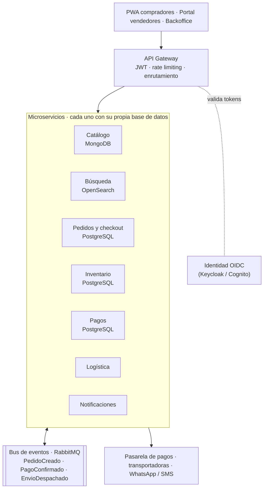

# Ejercicio 3 – Arquitectura de microservicios para un e-commerce agropecuario

> **Supuesto.** Marketplace de insumos agropecuarios en Colombia: varios vendedores (distribuidores) y compradores que son sobre todo productores rurales.

## 1. Qué exige el contexto agro

| Realidad | Consecuencia técnica |
|---|---|
| Conectividad rural intermitente | PWA *offline-first* y APIs **idempotentes** (reintentar sin duplicar pedidos) |
| Picos de demanda en siembra y fertilización | Escalado por servicio y **colas** que absorben los picos |
| Pago contraentrega, PSE y crédito | Pagos aislados y auditables; pedidos con estados intermedios |
| Última milla a veredas con transportadoras regionales | Logística desacoplada, seguimiento por eventos |
| Agroquímicos regulados (registro ICA) | Validaciones por producto y región en el checkout |

## 2. Decisión principal: empezar con un monolito modular

No empezaría con microservicios. Empezaría con un **monolito modular** (como el backend NestJS de este proyecto) y **extraería servicios poco a poco** (*strangler fig*) solo cuando haya una razón concreta: escalar distinto, aislar pagos, aislar terceros inestables o permitir que un equipo despliegue por su cuenta. Los microservicios cambian complejidad de código por complejidad operativa, y con un equipo pequeño eso frena más de lo que ayuda.

## 3. Arquitectura objetivo

| Servicio | Responsabilidad | Por qué separarlo |
|---|---|---|
| **Catálogo** (MongoDB) | Productos con atributos distintos por categoría, registro ICA | Esquema flexible; muchas lecturas |
| **Búsqueda** (OpenSearch) | Texto libre, sinónimos regionales ("abono" ↔ "fertilizante") | Escala distinto en temporada alta |
| **Pedidos y checkout** (PostgreSQL) | Ciclo de vida del pedido; coordina la compra | Núcleo del negocio, requiere consistencia |
| **Inventario** (PostgreSQL) | Stock por bodega y reservas con expiración | Evita sobreventa en los picos |
| **Pagos** (PostgreSQL) | Contraentrega, PSE, tarjeta, crédito | Cumplimiento y riesgo aislados |
| **Logística** | Fletes por municipio, guías, seguimiento | Integra terceros lentos sin bloquear la compra |
| **Notificaciones** | WhatsApp, SMS, email | Solo consume eventos |

La identidad se delega a un proveedor OIDC gestionado: es crítica y estándar, no conviene construirla.

## 4. Comunicación

- **Síncrono para consultar** (REST vía gateway; entre servicios con timeout, reintentos y *circuit breaker*).
- **Asíncrono para reaccionar**: eventos de negocio en **RabbitMQ** (Kafka solo si se necesita reprocesar el histórico).
- **La compra es una saga orquestada** ([diagrama](img/ej3-saga-checkout.svg)): crear pedido → reservar stock → autorizar pago → confirmar. Si un paso falla, se **compensan** los anteriores (liberar stock, cancelar pedido). No hay transacciones distribuidas.
- **Confiable con mala conectividad**: `Idempotency-Key` por compra (un reintento no cobra dos veces), *transactional outbox* (el evento se guarda en la misma transacción que el cambio) y consumidores idempotentes.

## 5. Datos, seguridad y operación

- **Una base de datos por servicio**; los datos ajenos se piden por API o se copian por eventos. Reportes en un *data warehouse*, no sobre las bases operacionales.
- **Seguridad**: JWT validado en el gateway y autorización de nuevo en cada servicio (un vendedor solo edita *sus* productos); mTLS entre servicios; tarjetas tokenizadas por la pasarela; datos personales según la Ley 1581 (Habeas Data). Detalle en el Ejercicio 5.
- **Operación**: trazas con OpenTelemetry, logs centralizados, contenedores gestionados (ECS / Cloud Run) con autoescalado para los picos de siembra, CI/CD independiente por servicio.

## 6. Trade-offs

| Decisión | Ganamos | Pagamos |
|---|---|---|
| Microservicios | Escalado y despliegue independientes, aislamiento de fallos | Latencia, consistencia eventual, más infraestructura |
| Base de datos por servicio | Autonomía y tecnología adecuada | Sin JOINs entre dominios, datos duplicados |
| Eventos asíncronos | Desacople y absorción de picos | Más difícil de depurar; entregas duplicadas |
| RabbitMQ antes que Kafka | Operación simple | Sin *replay* del histórico |

## 7. Plan de evolución

1. **Hoy: monolito modular.** `ProductsModule` es el futuro Catálogo; `AuthModule` se reemplaza por OIDC.
2. **Extraer Notificaciones y Búsqueda** (bajo acoplamiento, alto beneficio) e introducir el bus de eventos.
3. **Extraer Pagos y Logística** (aislar cumplimiento y terceros).
4. **Pedidos e Inventario con la saga**, cuando el volumen o los equipos lo justifiquen.
